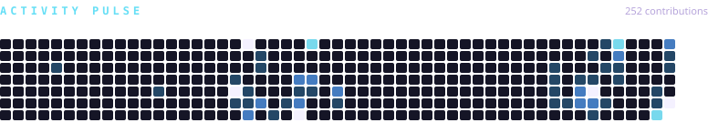

<!-- Edit this source, not README.md. Build: node .github/scripts/activity.mjs && npx readme-aura build -->

```aura width=860 height=1260 link="https://github.com/rjgrl"
(() => {
  const user = github?.user;
  const stats = github?.stats;
  const languages = github?.languages || [];
  const repos = (github?.repos || []).filter(repo => repo.name.toLowerCase() !== 'rjgrl').slice(0, 3);
  const accents = ['#67dff4', '#d5b1ed', '#ed78bd'];
  const heading = { display: 'flex', color: '#67dff4', fontSize: 12, fontWeight: 700, letterSpacing: 4 };
  return (
    <div style={{ display: 'flex', position: 'relative', width: '100%', height: '100%', overflow: 'hidden', borderRadius: 26, border: '1px solid #29203f', background: '#070710', color: '#f8f6ff', fontFamily: 'Inter' }}>
      <style>{`
        @keyframes aura-drift {
          0%, 100% { transform: translate(-24px, 0px); opacity: 0.55; }
          50% { transform: translate(64px, -12px); opacity: 1; }
        }
        @keyframes aura-counter-drift {
          0%, 100% { transform: translate(24px, 0px); opacity: 1; }
          50% { transform: translate(-56px, 12px); opacity: 0.55; }
        }
        #aura-stats { animation: aura-drift 8s ease-in-out -2s infinite; }
        #aura-analytics { animation: aura-counter-drift 10s ease-in-out -3s infinite; }
        #aura-activity { animation: aura-drift 10s ease-in-out -1.5s infinite; }
        #aura-projects { animation: aura-counter-drift 9s ease-in-out -1s infinite; }
        @media (prefers-reduced-motion: reduce) {
          #aura-stats, #aura-analytics, #aura-activity, #aura-projects { animation: none !important; }
        }
      `}</style>
      <svg width="860" height="1260" style={{ position: 'absolute', top: 0, left: 0 }}>
        <defs>
          <radialGradient id="violet"><stop offset="0%" stopColor="#6515bd" stopOpacity="0.7"/><stop offset="100%" stopColor="#6515bd" stopOpacity="0"/></radialGradient>
          <radialGradient id="cyan"><stop offset="0%" stopColor="#008fa7" stopOpacity="0.6"/><stop offset="100%" stopColor="#008fa7" stopOpacity="0"/></radialGradient>
          <radialGradient id="blue"><stop offset="0%" stopColor="#354bf4" stopOpacity="0.55"/><stop offset="100%" stopColor="#354bf4" stopOpacity="0"/></radialGradient>
        </defs>
        <ellipse cx="230" cy="150" rx="230" ry="105" fill="url(#violet)"/>
        <ellipse cx="115" cy="185" rx="135" ry="85" fill="url(#blue)"/>
        <ellipse cx="650" cy="170" rx="200" ry="100" fill="url(#cyan)"/>
        <g id="aura-stats">
          <ellipse cx="425" cy="447" rx="300" ry="58" fill="url(#violet)"/>
        </g>
        <g id="aura-analytics">
          <ellipse cx="695" cy="652" rx="165" ry="90" fill="url(#violet)" opacity="0.55"/>
          <ellipse cx="190" cy="640" rx="175" ry="75" fill="url(#cyan)" opacity="0.3"/>
        </g>
        <g id="aura-activity">
          <ellipse cx="200" cy="850" rx="200" ry="80" fill="url(#violet)" opacity="0.6"/>
          <ellipse cx="650" cy="870" rx="190" ry="70" fill="url(#cyan)" opacity="0.55"/>
        </g>
        <g id="aura-projects">
          <ellipse cx="175" cy="1055" rx="200" ry="150" fill="url(#cyan)" opacity="0.55"/>
          <ellipse cx="690" cy="1070" rx="200" ry="150" fill="url(#violet)" opacity="0.65"/>
        </g>
        <circle cx="430" cy="150" r="128" fill="none" stroke="#6a7fbc" strokeOpacity="0.15"/>
        <path d="M30 22V12H48 M812 12H830V24 M30 276V288H48 M812 288H830V276" fill="none" stroke="#71cde6" strokeWidth="2" opacity="0.7"/>
        {Array.from({ length: 28 }, (_, i) => <circle key={i} cx={45 + (i * 193) % 770} cy={20 + (i * 137) % 1200} r={i % 3 === 0 ? 1.8 : 1} fill={accents[i % 3]} opacity={i % 4 === 0 ? 0.85 : 0.22}/>)}
        {[312, 402, 532, 758, 942].map(y => <path key={y} d={`M28 ${y}H832`} stroke="#20152f" strokeOpacity="0.65"/>)}
      </svg>

      <div style={{ display: 'flex', position: 'absolute', top: 50, left: 42, width: 776, flexDirection: 'column', alignItems: 'center' }}>
        <div style={{ display: 'flex', fontSize: 50, fontWeight: 900, letterSpacing: 16, textShadow: '0 0 18px #e7a0ee', textTransform: 'uppercase' }}>{user?.name || user?.login || 'Zul'}</div>
        <div style={{ ...heading, marginTop: 22, letterSpacing: 6, fontSize: 11 }}>EXPLORING THE WORLD OF CODE</div>
        <div style={{ display: 'flex', marginTop: 32, maxWidth: 630, textAlign: 'center', justifyContent: 'center', fontSize: 13, lineHeight: 1.6, color: '#c4a7df', letterSpacing: 1.5 }}>{user?.bio || 'College student who loves exploring the world of programming.'}</div>
        <div style={{ display: 'flex', marginTop: 18, color: '#787498', fontSize: 10, letterSpacing: 2 }}>github.com/rjgrl</div>
      </div>

      <div style={{ display: 'flex', position: 'absolute', top: 334, left: 42, width: 776, justifyContent: 'center', gap: 8, flexWrap: 'wrap' }}>
        {(languages.length ? languages.slice(0, 8).map(l => l.name) : ['Always learning']).map((name, i) => <div key={name} style={{ display: 'flex', padding: '7px 16px', fontSize: 11, fontWeight: 700, color: accents[i % 3], border: '1px solid #3c344e', borderRadius: 22, background: '#0c0b16' }}>{name}</div>)}
      </div>

      <div style={{ display: 'flex', position: 'absolute', top: 423, left: 42, width: 776 }}>
        {[
          ['STARS', stats?.totalStars, '#ffe766'],
          ['FORKS', stats?.totalForks, '#d5b1ed'],
          ['REPOS', stats?.totalRepos, '#67dff4'],
          ['REPO COMMITS', stats?.totalCommits, '#ed78bd'],
        ].map(([label, value, color]) => <div key={label} style={{ display: 'flex', width: '25%', flexDirection: 'column', alignItems: 'center', gap: 9 }}><div style={{ display: 'flex', fontSize: 30, fontWeight: 900 }}>{value == null ? '—' : value.toLocaleString('en-US')}</div><div style={{ display: 'flex', fontSize: 9, fontWeight: 800, letterSpacing: 3, color }}>{label}</div></div>)}
      </div>

      <div style={{ display: 'flex', position: 'absolute', top: 548, left: 42, width: 776, flexDirection: 'column' }}>
        <div style={heading}>STACK ANALYTICS</div>
        <div style={{ display: 'flex', width: '100%', height: 9, borderRadius: 5, overflow: 'hidden', marginTop: 24, background: '#151526' }}>
          {languages.filter(l => l.percentage > 0).map(l => <div key={l.name} style={{ display: 'flex', height: 9, flexGrow: l.percentage, flexBasis: 0, background: l.color || '#67dff4', borderRadius: 4 }}/>) }
        </div>
        <div style={{ display: 'flex', flexWrap: 'wrap', marginTop: 18, rowGap: 20 }}>
          {languages.map(l => <div key={l.name} style={{ display: 'flex', width: '20%', alignItems: 'center', gap: 6, fontSize: 10 }}><div style={{ display: 'flex', width: 10, height: 10, borderRadius: 5, background: l.color || '#67dff4' }}/><span style={{ fontWeight: 600 }}>{l.name}</span><span style={{ color: '#8e88ac' }}>{l.percentage}%</span></div>)}
          {!languages.length && <div style={{ display: 'flex', color: '#8e88ac', fontSize: 12 }}>Language data unavailable — rebuild with a GitHub token.</div>}
        </div>
        <div style={{ display: 'flex', marginTop: 22, fontSize: 9, color: '#77708f', letterSpacing: 1 }}>PRIMARY LANGUAGES · SHARE OF PUBLIC REPOSITORIES</div>
      </div>

      

      <div style={{ display: 'flex', position: 'absolute', left: 42, top: 958, width: 776, flexDirection: 'column' }}>
        <div style={heading}>PRIMARY DEPLOYMENTS</div>
        <div style={{ display: 'flex', gap: 16, marginTop: 10 }}>
          {repos.map((repo, i) => <div key={repo.name} style={{ display: 'flex', flexDirection: 'column', width: 248, height: 192, padding: 18, border: `1px solid ${['#2e5261', '#54415f', '#60374f'][i]}`, borderRadius: 20, background: 'rgba(10,9,19,0.85)' }}>
            <div style={{ display: 'flex', fontSize: 16, fontWeight: 800, overflow: 'hidden', height: 40, wordBreak: 'break-all' }}>{repo.name.length > 22 ? repo.name.slice(0, 20) + '…' : repo.name}</div>
            <div style={{ display: 'flex', fontSize: 11, lineHeight: 1.6, color: '#b9afd2', marginTop: 6, height: 64, overflow: 'hidden' }}>{repo.description ? (repo.description.length > 95 ? repo.description.slice(0, 92) + '…' : repo.description) : 'Explore this project on GitHub.'}</div>
            <div style={{ display: 'flex', alignItems: 'center', justifyContent: 'space-between', borderTop: '1px solid #201a2d', paddingTop: 12, marginTop: 10, fontSize: 10 }}>
              <div style={{ display: 'flex', alignItems: 'center', gap: 6, color: accents[i] }}><div style={{ display: 'flex', width: 10, height: 10, borderRadius: 5, background: accents[i] }}/>{repo.language || 'Code'}</div>
              <div style={{ display: 'flex', color: '#8e88ac' }}>stars {repo.stars} · forks {repo.forks}</div>
            </div>
          </div>)}
          {!repos.length && <div style={{ display: 'flex', color: '#8e88ac', fontSize: 12, paddingTop: 20 }}>Repository data unavailable — rebuild with a GitHub token.</div>}
        </div>
      </div>
      <div style={{ display: 'flex', position: 'absolute', top: 1230, width: 860, justifyContent: 'center', color: '#77708f', fontSize: 8, letterSpacing: 3 }}>RJGRL · ALWAYS EXPLORING · README AURA</div>
    </div>
  );
})()
```
